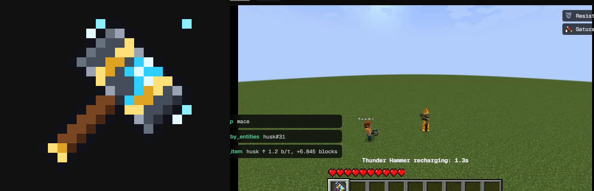
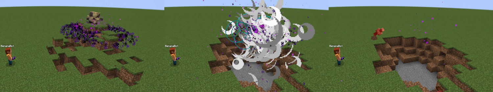

# 🍌 Benana Mod Studio

**Type a Minecraft mod idea. Go get a snack. Come back to a working, tested mod.**

Benana writes your idea as a Paper plugin, boots a Minecraft server inside the app, and sends an AI player in to actually *play* it. If something breaks, a fixer agent reads what went wrong, patches it, and the AI goes back in for another round. When it's done, put it on the marketplace where anyone can remix it, and ask your CFO whether it'll make money.

No IDE. No Gradle errors at 2am. No hand-drawing 256 pixels of a sword.


## Mods it cooked up

All of these came out of one or two sentences. No human touched the code.

### ⚡ Thunder Hammer

> "Thunder Hammer: a heavy hammer item with its own hand-drawn texture. Right-click strikes lightning where you are looking and launches every mob within 6 blocks into the air with electric spark particles. 4 second cooldown per player."

The agent drew the hammer itself (left), built the plugin, and the AI player bonked a husk 6.8 blocks into the sky. Every check passed on the first try, for **$2.10**.



### 🕳️ Black Hole Grenade

> "Black Hole Grenade: a dark orb you throw like a snowball. Where it lands, a black hole opens for 5 seconds… then it collapses with a huge explosion that flings every mob caught in it high into the sky."

Then we asked it to **"make it way crazier"**, and it did. The black hole now rips the ground up and spirals the blocks into the vortex, and the collapse brings lightning and leaves a crater. The playtester measured a husk dragged from 4.9 to 0.5 blocks off the impact point and then yeeted 26 blocks up. The log reads "ripped 40 blocks, crater 189 blocks". Two prompts, every check green both times, **$2.29** total.



### 🏹 ArrowTracer (the one that fought back)

Took three attempts, and that's the fun part. See [When a playtest fails, it fixes itself](#-when-a-playtest-fails-it-fixes-itself).

## ✍️ Start with one sentence

> "A golden sword that launches any mob it hits into the sky with particles, with a 3 second cooldown."

Type an idea (or steal one of the examples) and hit Enter. Under the examples you'll see the lessons the fixer picked up from earlier mods. Every new build gets them for free.


## 🧠 What happens under the hood

1. **Spec agent** (Claude Opus) turns your sentence into rules and an in-game **test plan** with real numbers, like "the husk's upward velocity exceeds 0.8 blocks/tick". No vibes allowed.
2. **Builder** (Claude Code, Opus) writes the plugin in its own git repo, created from `templates/paper-plugin`, and Maven builds it.
3. **Deploy**: Benana restarts its local Paper 1.21.4 server with the new jar. About 16 seconds.
4. **Playtester** (Claude Code, Sonnet) drives `BenanaBot`, a real player, through the `minecraft` MCP tools. It equips, attacks, uses items, and tracks an entity's velocity tick by tick, then reports pass, fail or blocked for every check, with measurements as receipts.
5. **Fixer** (Claude Code, Opus) gets the verdict, the server stack traces, the mod's Entire checkpoint history and the Neatlogs trace of the failed playtest. It fixes the root cause, writes down a **lesson**, and the loop goes again (up to 3 attempts).

## 👀 Watch the AI play it

The live view is a real Minecraft 1.21.4 client spectating next to BenanaBot. You get the game's own particles, lightning, textures and boss bars, not a fake renderer. The bot grabs the item, spawns a victim, and goes to town. The server log streams right next to it, so plugin errors show up live.

## 🎮 Play it yourself

**Play in Minecraft** opens a second real Minecraft window and drops you into the same world next to the bot, holding the mod's items (plus husk eggs, for science). Benana grabs the vanilla client files from Mojang the first time and joins its own local server. Set `BENANA_PLAYER_NAME` in `.env` to pick your name.


## 🔧 When a playtest fails, it fixes itself

A red check isn't game over. Every attempt keeps the measured evidence, the agent sessions behind it, and the fixer's lesson.

Meet ArrowTracer. The request was "can't see the arrows being shot". The first build said the arrow landed 1.3 blocks from the shooter, but it was really 7 to 9. The fixer traced the impact point along the arrow's velocity and wrote that down as a lesson. The playtest *still* failed. On attempt three the fixer realized the plugin was fine: the husk had wandered up to the bot before the shot. So it gave the husk NoAI (sit still, buddy), and all four checks passed. Total damage to the wallet: $1.32.


## 🔍 Every agent session is traced (Neatlogs)

Every builder, playtester and fixer session is traced through `@neatlogs/claude-code` hooks installed in each mod repo. The **Neatlogs** page lists every session across every mod. Open one to see its cost, tokens, the failure it was handed, each tool call and its final answer. The fixer reads the failed playtest's trace before it touches any code.


## 🧾 Every commit remembers who wrote it (Entire)

Each agent commit carries an `Entire-Checkpoint` trailer linking the code to the session that wrote it. The **Entire** page shows each mod's history in order (builder, playtest, fixer) with the checkpoint behind every commit. The fixer gets this history as context, so it knows what was already tried.


## 🛒 Marketplace, hosted on Entire

The **Marketplace** lists published mods with their version, checkpoints, remixes and playtest result. Publishing pushes the mod to an Entire repo along with only the checkpoints behind it, so every listing shows exactly how the agents built it.


**Remix** lets you fork any mod from any checkpoint. Benana clones the listing from Entire, checks out that checkpoint's commit, and hands the new build the parent's spec, test plan, attempts and lessons. Your agent starts where the last one stopped, and your remix gets its own listing.


The nerdy details (publishing, privacy, remixes, and what we actually tested against the Entire CLI) live in [docs/marketplace/SPEC.md](docs/marketplace/SPEC.md).

## 💸 Creator CFO, powered by cfo.ai

Making mods costs real money in agent time, so the **CFO** page keeps the books for every mod: build cost, money burned on fix attempts, first-try pass rate, and how many $1.99 sales pay a mod back.

- **Ask your CFO** answers pricing, budget and runway questions by calling your cfo.ai model over its MCP server, and shows every cfo.ai call it made.
- **Quote a mod before you build it** estimates a new idea's cost from your most similar past builds and how often they needed fixes. Find out if the dragon pet is worth it *before* you pay for it.


## 📊 Insights

The **Insights** page tracks build outcomes, pass rate, first-try passes, and spend by agent role and model. It answers "how good is the agent getting?" with numbers.


## 🤝 Partner tools

- **Neatlogs** traces every agent session.
- **Entire** checkpoints every attempt and hosts the marketplace. This repo has Entire turned on too.
- **cfo.ai** powers the CFO page over MCP and holds the business plan: [docs/hackathon/cfo-plan.md](docs/hackathon/cfo-plan.md).

## 📣 Built in public

Benana was built in public on X under #neatHack, and people showed up asking questions mid-build, like [PressX asking which Minecraft versions we support](https://x.com/PressX_Global/status/2109273926962483588). (1.21.4 today, more coming. Join the waitlist!)

## 🚀 Run it

You'll need Node 22+ on `PATH` (the game bot runs on system Node), JDK 21, Maven 3.9, and Claude Code logged in. For partner evidence, install the [Entire CLI](https://github.com/entireio/cli) and `npm i -g @neatlogs/claude-code`.

```sh
npm ci
cp .env.example .env     # add Neatlogs keys
npm run dev
```

Click **Start game**, describe a mod, and press Enter. The first start downloads Paper (51 MB). Game data lives in `~/.benana/game` and mod repos in `~/.benana/mods`.

- `BENANA_GAME_AUTOSTART=1` starts the game with the app. `BENANA_GAME_DEMO=1` turns on attract mode, where the bot launches husks forever. `BENANA_VIEW=first` switches the live view to the bot's first-person camera.
- **Seeded bug** (the toggle under the prompt) starts from `fixtures/seeded`, a LaunchSword with a planted knockback bug. The playtester and fixer still run for real, and the UI labels the run as seeded.
- If Electron crashes at startup with `reading 'handle'`, unset `ELECTRON_RUN_AS_NODE`.

```sh
npm run build
npm test
```

Architecture and interfaces: [docs/hackathon/CONTRACTS.md](docs/hackathon/CONTRACTS.md). Build plan: [docs/hackathon/PLAN.md](docs/hackathon/PLAN.md). The original repository-bug workspace is still in the sidebar under **Repository workspace**; see [execute_yourself.md](execute_yourself.md).
