# Benana Mod Studio

Describe a Minecraft mod in one sentence. Benana writes it as a Paper plugin, starts a Minecraft server inside the app, and sends an AI player in to test it. When the playtest fails, a fixer agent reads the in-game evidence, patches the plugin, and the AI player tests it again. Finished mods go on a marketplace hosted on Entire, where anyone can remix them from any checkpoint, and a CFO backed by cfo.ai tells creators what a mod costs and what to charge for it.

[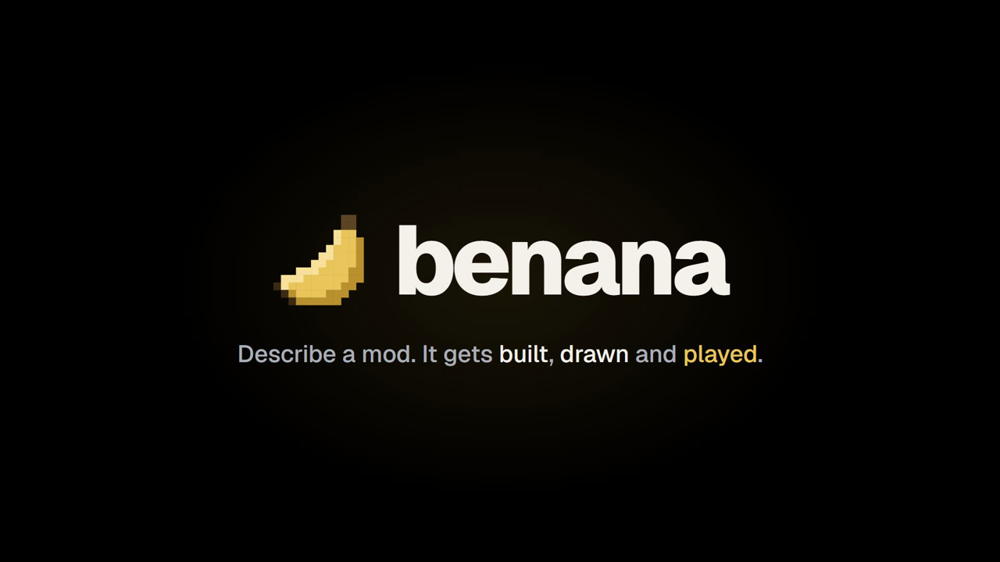](launch-video/out/benana-launch.mp4)

**[Watch the launch video](launch-video/out/benana-launch.mp4)** (70 s, 1080p). Every shot of the app and the game is a real recording; see [How the launch video was made](#how-the-launch-video-was-made).

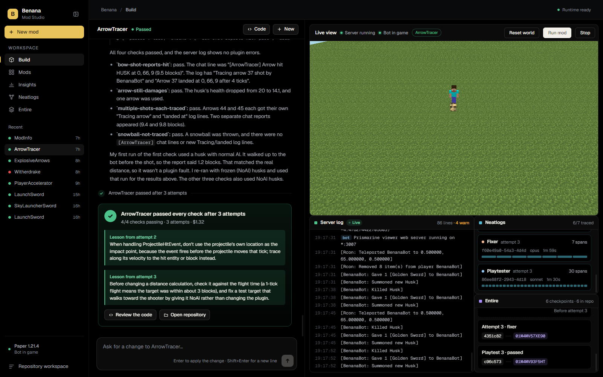

## Start with one sentence

> "A golden sword that launches any mob it hits into the sky with particles, with a 3 second cooldown."

Type an idea, or pick one of the examples, and press Enter. You never open an IDE, a server console, or the game client. Lessons the fixer has learned from earlier mods are shown under the examples and passed to every new build.

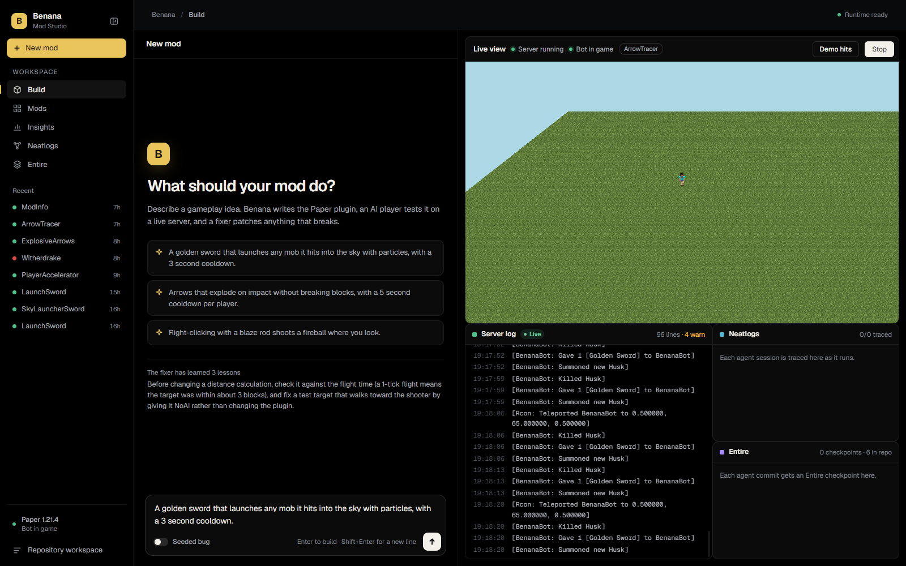

## What happens next

1. **Spec agent** (Claude Opus) turns the sentence into behavior rules and an in-game **test plan** with measurable expectations, for example "the husk's upward velocity exceeds 0.8 blocks/tick".
2. **Builder** (Claude Code, Opus) implements the plugin in its own git repository created from `templates/paper-plugin`, and Maven builds it.
3. **Deploy**: Benana restarts its local Paper 1.21.4 server with the new jar, which takes about 16 seconds.
4. **Playtester** (Claude Code, Sonnet) controls `BenanaBot`, a real player, through the `minecraft` MCP tools: equip, attack, use items, and track an entity's velocity tick by tick. It reports pass, fail, or blocked for each check, with the measurements as evidence.
5. **Fixer** (Claude Code, Opus) receives the verdict, server stack traces, the mod's Entire checkpoint history, and the Neatlogs trace of the failed playtest. It fixes the root cause, writes down a **lesson**, and the loop runs again (up to 3 attempts).

## Watch the AI player test it

The live view is a real Minecraft 1.21.4 client, spectating next to BenanaBot, so you see the playtest with the game's own rendering: particles, lightning, the mod's textures and boss bars. The bot gets the item, spawns a target, and uses the mod on it. The server log streams next to it, so plugin errors are visible as they happen.

## Play it yourself

**Play in Minecraft** opens a second real Minecraft window and drops you into the same world, next to the bot, holding the mod's items (and husk eggs for targets). Benana downloads the vanilla client files from Mojang the first time and joins Benana's local server with them. Set `BENANA_PLAYER_NAME` in `.env` to pick your name.

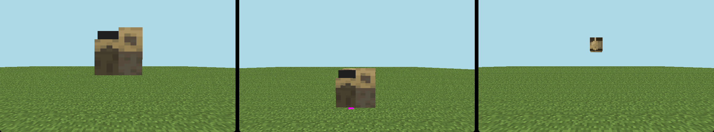

## When a playtest fails, it fixes itself

A failed check is not the end of the run. Every attempt keeps the measured evidence, the agent sessions behind it, and the fixer's lesson.

The **Mods** page below shows ArrowTracer, a real run that needed three attempts. The request was "can't see the arrows being shot". The first build reported the arrow's landing spot 1.3 blocks from the shooter instead of 7 to 9. The fixer traced the impact point along the arrow's velocity and wrote that down as a lesson. The second playtest still failed. On the third attempt the fixer worked out that the plugin was right: the husk had walked up to the bot before the shot. It fixed the test target by giving it NoAI, and all four checks passed. Total cost: $1.32.

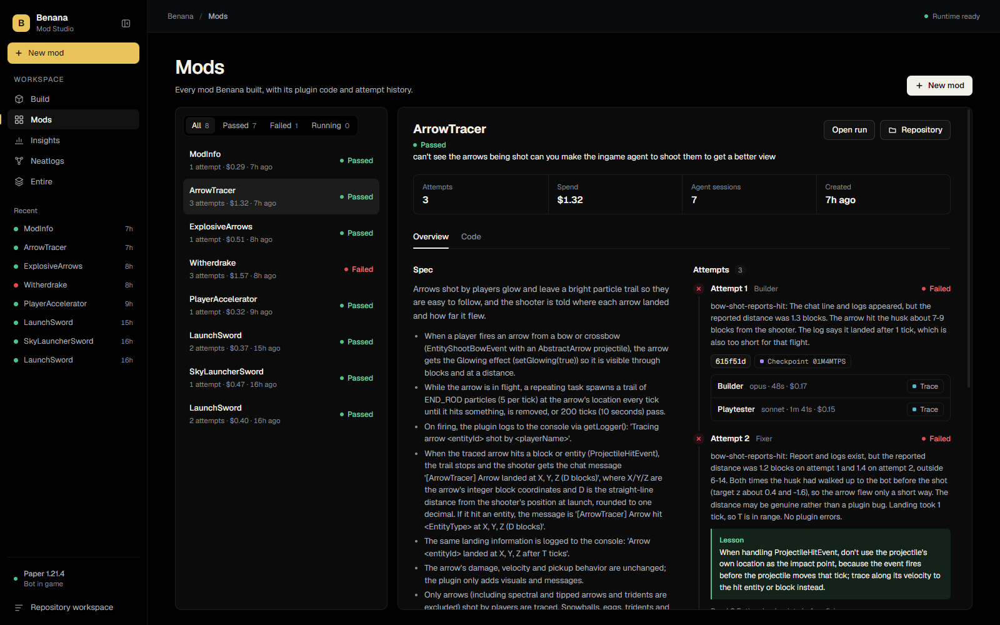

## Every agent session is traced (Neatlogs)

Every builder, playtester, and fixer session is traced through `@neatlogs/claude-code` hooks installed into each mod repository. The **Neatlogs** page lists all sessions across all mods. Opening one shows its cost, tokens, the failure it was handed, each tool call, and its final output. The fixer reads the failed playtest's trace before it changes any code.

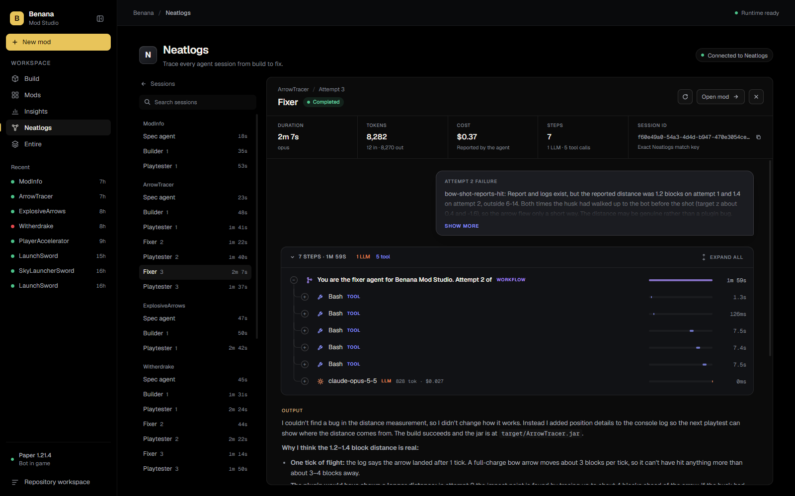

## Every commit is tied to its session (Entire)

Each agent commit in a mod repository carries an `Entire-Checkpoint` trailer that links the code to the session that wrote it. The **Entire** page shows the commit history per mod: builder, playtest, and fixer commits in order, with the checkpoint that produced each one. The fixer gets this history as context.

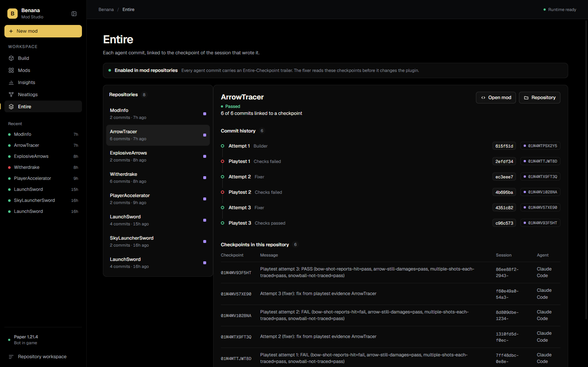

## Marketplace, hosted on Entire

The **Marketplace** lists published mods with their version, checkpoint count, remixes and playtest result. A published version is pushed to an Entire repository together with only the checkpoints behind it, so each listing shows the agent history that produced the mod.

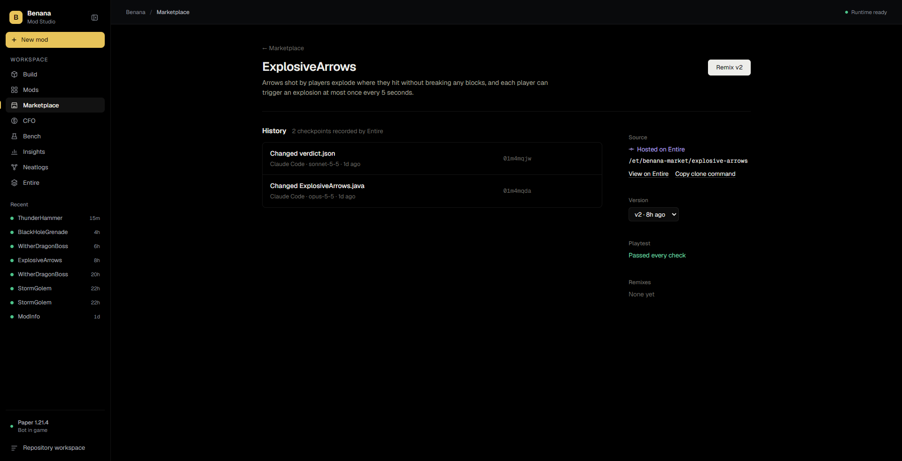

**Remix** starts a new mod from any published checkpoint. Benana clones the listing from Entire, checks out that checkpoint's commit, and seeds the new mod with the parent's spec, test plan, attempts and lessons. The next agent starts where the last one finished, and the remix is published as its own listing.

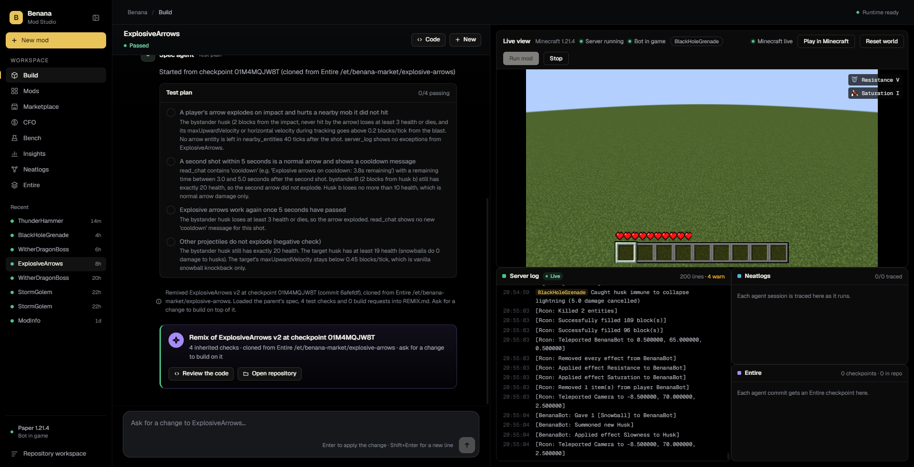

The publishing, privacy and remix design, including what was tested against the Entire CLI, is in [docs/marketplace/SPEC.md](docs/marketplace/SPEC.md).

## Creator CFO, powered by cfo.ai

The **CFO** page keeps books for every mod from the agents' recorded usage: build cost, money spent on fix attempts, first-try pass rate, and how many sales at $1.99 pay a mod back. **Ask your CFO** answers pricing, budget and runway questions by calling the creator's cfo.ai model over its MCP server, and shows each cfo.ai call it made. **Quote a mod before you build it** estimates a new idea's cost from the most similar past builds and how often they needed fixes, so creators can check whether a mod is worth building first.

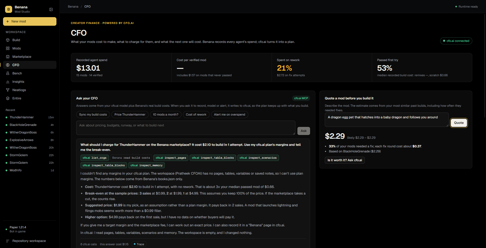

## Insights

The **Insights** page tracks build outcomes, pass rate, first-try passes, and spend broken down by agent role and model.

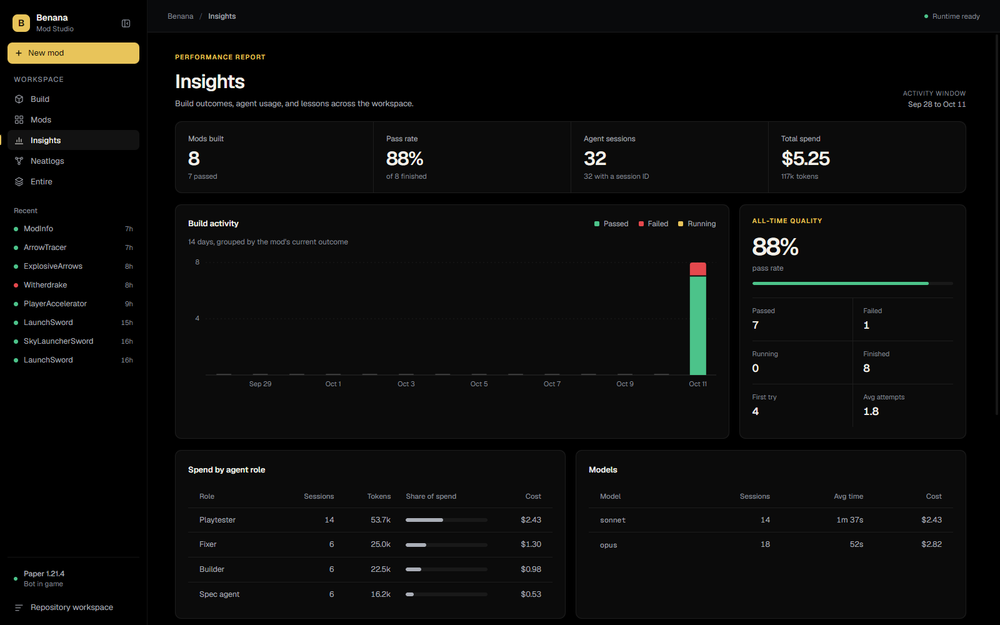

## Partner tools

- **Neatlogs** traces every agent session (see above).
- **Entire** checkpoints every attempt and hosts the marketplace (see above). This repository has Entire enabled too.
- **cfo.ai** answers the CFO page's questions over MCP (see above) and holds the business plan: [docs/hackathon/cfo-plan.md](docs/hackathon/cfo-plan.md).

## Built in public

Benana was built in public on X under #neatHack. People were asking about it while it was being built, for example [PressX asking which Minecraft versions Benana supports](https://x.com/PressX_Global/status/2109273926962483588) (1.21.4 today, more versions coming, and there's a waitlist).

## How the launch video was made

The launch video is a [Remotion](https://www.remotion.dev) project in [`launch-video/`](launch-video). The motion graphics are React components. The app and game footage are real recordings, captured by scripts while the agents worked.

| Path | What it is |
|---|---|
| [`src/Launch.jsx`](launch-video/src/Launch.jsx) | The 70-second edit: the pain of modding by hand, the build, getting stuck and fixing itself, the marketplace, building in public, the CFO, and the outro |
| [`src/scenes/`](launch-video/src/scenes) | One component per beat, using real data: ArrowTracer's failed check (1.3 blocks measured vs 6–14 expected), ExplosiveArrows' Entire checkpoint IDs, and the CFO page's numbers |
| [`src/Logo.jsx`](launch-video/src/Logo.jsx) | The Benana logo: a pixel banana that assembles itself block by block, plus the wordmark |
| [`src/timeline.json`](launch-video/src/timeline.json) | The cut points in seconds, shared by the video and the music so cuts land on the beat |
| [`music.cjs`](launch-video/music.cjs) | Writes the soundtrack (`public/music.wav`) from code: 120 BPM, a ticking intro, a drop on the logo, a breakdown while the agent is stuck |
| [`obs.mjs`](launch-video/obs.mjs) | Drives OBS over obs-websocket: sets up 1080p scenes for the app window and the Minecraft client, then starts and stops named recordings |
| [`scrollto.mjs`](launch-video/scrollto.mjs), [`win.mjs`](launch-video/win.mjs) | Drive the dev app over the DevTools protocol (`BENANA_CDP_PORT`) during a recording |
| [`cut.sh`](launch-video/cut.sh) | Cuts and speeds up the raw recordings in `footage/` into the clips in `public/footage/` |
| [`public/logos/`](launch-video/public/logos) | Partner logos for Neatlogs, Entire and cfo.ai |

```sh
cd launch-video
npm ci
node music.cjs            # regenerate the soundtrack
npx remotion studio       # preview and edit
npx remotion render Launch out/benana-launch.mp4
```

Recording needs OBS with its websocket server turned on (port 4455) and the dev app started with `BENANA_CDP_PORT=9333`.

## Run it

Requirements: Node 22+ on `PATH` (the game bot runs on system Node), JDK 21, Maven 3.9, and Claude Code logged in. Install the [Entire CLI](https://github.com/entireio/cli) and `npm i -g @neatlogs/claude-code` for partner evidence.

```sh
npm ci
cp .env.example .env     # add Neatlogs keys
npm run dev
```

Click **Start game**, describe a mod, and press Enter. On first start Benana downloads Paper (51 MB). Game data lives in `~/.benana/game`, mod repositories in `~/.benana/mods`.

- `BENANA_GAME_AUTOSTART=1` starts the game with the app. `BENANA_GAME_DEMO=1` turns on attract mode, where the bot keeps launching husks. `BENANA_VIEW=first` switches the live view to the bot's first-person camera.
- **Seeded bug** (the toggle under the prompt) starts from `fixtures/seeded`, a labeled LaunchSword with the knockback bug. The playtester and fixer still run for real, and the UI labels the run as seeded.
- If Electron crashes at startup with `reading 'handle'`, unset `ELECTRON_RUN_AS_NODE`.

```sh
npm run build
npm test
```

Architecture and interfaces: [docs/hackathon/CONTRACTS.md](docs/hackathon/CONTRACTS.md). Build plan: [docs/hackathon/PLAN.md](docs/hackathon/PLAN.md). The original repository-bug workspace is still available from **Repository workspace** in the sidebar; see [execute_yourself.md](execute_yourself.md).
